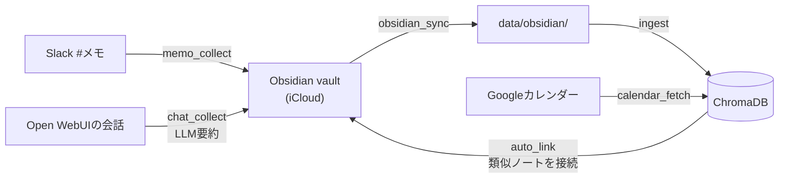
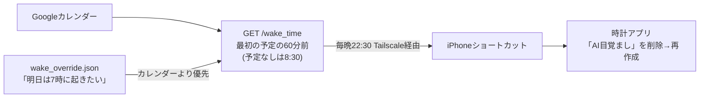

# personalAI

自分専用のローカルAI秘書。自分の情報（プロフィール・予定・メモ・AIとの会話など）をベクトルDBに蓄積し、外部サービスにデータを渡さずプライベートな環境で **エージェント × RAG × ローカルLLM** を組み合わせて動かすプロジェクトです。iPhoneからも利用できます。

## 概要

「自分のデータをクラウドに預けずに、自分専用のAIを持ちたい」という動機でスタートしました。Open WebUI をフロントに、自前の OpenAI 互換 API サーバー（FastAPI）を挟み、**LangGraph のエージェント**が「そのまま答えるか、道具を使うか」を判断して応答します。道具はローカルRAG検索（LlamaIndex + ChromaDB）、Googleカレンダー・Anki・Slack操作（MCP経由）、乗換案内、目覚まし設定など。

さらに毎晩のバッチが Slack のメモや AI との会話を Obsidian vault に回収・要約し、ノート同士を自動リンクして RAG に取り込みます。**「日中に見聞きしたことが、翌朝には AI 自身の記憶になっている」** サイクルを回すことを目指しています。

## 主な機能

### 会話AI（LangGraphエージェント）

Open WebUI からの質問を受け、エージェントが必要に応じて道具を呼び出してから回答します。

| 道具 / 仕組み | 内容 |
|------|------|
| `note_search` | LlamaIndex Retriever で ChromaDB を検索（ノート・会話の要約・予定の記録）。関係ない結果なら「見当たらない」と答えるよう、結果に読み方を添えて渡す |
| `calendar_*` / `anki_*` / `slack_*` | Googleカレンダーの予定操作、Ankiの学習状況確認・カード追加、Slackへの投稿・予約投稿（「◯時にリマインドして」）。**mcpo の openapi.json から起動時に自動生成**するため、MCP側でツールを増やしてもコード修正不要。Ankiのノート削除のように取り返しのつかない道具は denylist で持たせない |
| `transit_search` | 乗換案内（NAVITIME API）。「明日9時に梅田に着きたい」で到着時刻指定にも対応。**出発地はiPhone/ブラウザの現在地**、取れなければ自宅 |
| `map_link` | 施設名からGoogleマップのリンクを作る（iPhoneではタップでマップアプリが開く） |
| `set_wake_time` / `get_wake_time` | 「明日は7時に起きたい」で目覚ましを手動設定・確認。「やっぱりカレンダー通りで」で解除 |
| 会話履歴・日付認識 | 直近20メッセージの履歴を毎回付与。現在日時と天気は**最後の質問の直前**に差し込む（プロンプトキャッシュを壊さないため。[高速化](#パフォーマンス改善12bを速く動かす)参照） |
| 現在地の受け取り | Open WebUIの位置情報を、システムプロンプトの `現在地: {{USER_LOCATION}}` 経由で受け取る。座標はLLMに書き写させず、サーバー側で抜き出して道具へ渡す（小型モデルは数字を崩すため） |
| ツール偽装対策 | 小型モデルが道具を呼ばずに「追加しました」と嘘の完了報告をする問題をプロンプトで抑止 |

### 目覚まし自動設定（iPhoneショートカット連携）

カレンダーの予定から起床時刻を計算し、iPhoneの時計アプリに毎晩自動セットします。

- 起床時刻 = その日最初の予定の **60分前**（予定なしは8:30。8:30より遅くはしない）
- 会話で「明日は7時に起きたい」と言えば手動上書き（`data/wake_override.json`、カレンダーより優先）
- iPhoneショートカットが毎晩22:30に `GET /wake_time` を叩き、「AI目覚まし」アラームを削除→再作成
- Mac に届かない夜は前日の時刻のまま鳴る（繰り返しアラームを保険にした設計）

### 夜間バッチ — 記憶の定着（毎晩5:00）

fail-fast のパイプラインで、1日の情報を vault → ChromaDB へ流し込みます。

| 順 | スクリプト | 内容 |
|:--:|------|------|
| 1 | `memo_collect.py` | Slack #メモ の投稿を vault の inbox/ へ回収（処理済みは✅リアクションで管理） |
| 2 | `chat_collect.py` | Open WebUI の会話をLLMが要約して vault へ（記録する価値があるかも LLM が判断） |
| 3 | `obsidian_sync.py` | iCloud 上の Obsidian vault を `data/obsidian/` に同期 |
| 4 | `ingest.py` | `data/` 以下のMDを ChromaDB に取り込み（upsert対応。入力から消えたファイルはDBからも削除） |
| 5 | `auto_link.py` | 埋め込みのコサイン類似度でノート同士を Obsidian の `[[リンク]]` で自動接続 |
| 6 | `calendar_fetch.py` | Googleカレンダーの予定を ChromaDB に取り込み |

**RAGに入れるものの方針**：「自分が書いたもの・考えたこと・決めたこと」は入れる。「世の中にあるもの（家電の説明書など）・毎日変わる数字（Anki・Beeminderなど）」は入れずに、ネットや道具に任せる。この方針で、以前取り込んでいた書類写真のMD（全体の4割を占め、一度も質問されていなかった）は除外した（`image_ingest.py` は現在停止中）。

### 朝の配信・学習支援（Slack）

| スクリプト | 実行 | 内容 |
|------|------|------|
| `morning_briefing.py` | 毎朝8:00 | 天気・今日の予定・Anki残数・Beeminderのゴール状況を #秘書室 に投稿。Beeminderは personal-mcp を**stdioで直接起動**して道具を呼ぶ（API処理をMCPに一本化、Docker不要） |
| `news_digest.py` | 毎朝8:10 | AIニュース（RSS）をLLMで英語要約して #AIニュース に配信。日本語訳はスレッドに畳む学習動線 |
| `english_assistant.py` | 毎分 | #英語 チャンネルの見張り番。投稿に翻訳・例文を自動返信し、📌を付けた単語は音声付きで Anki カード化（edge-tts） |

### 運用・監視

- バッチ失敗は **どのステップで死んだかを Slack #エラー へ即通知**（trap ERR + fail-fast）
- 成功しても異常に遅い場合（30分超）は通知（「7時間半かかっても無音」だった死角への対策）
- Ollama が落ちている夜は残りをスキップして正常終了（次回自然に回復）

## アーキテクチャ

### 会話の流れ（オンライン）

```mermaid
flowchart TD
    iPhone([iPhone / ブラウザ])
    iPhone -->|Tailscale + HTTPS<br/>(tailscale serve)| WebUI

    subgraph Docker["Docker (docker-compose)"]
        WebUI["Open WebUI :8080"]
        API["FastAPI server :8000<br/>(OpenAI互換API)"]
        Agent["LangGraphエージェント<br/>(道具を使うか判断)"]
        RAG["note_search<br/>(LlamaIndex Retriever)"]
        Wake["set/get_wake_time"]
        Transit["transit_search<br/>map_link"]
        MCPO["mcpo :8600<br/>(MCP→REST変換・内部限定)"]
        WebUI -->|質問＋現在地| API --> Agent
        Agent --> RAG
        Agent --> Wake
        Agent --> Transit
        Agent -->|calendar_* / anki_* / slack_*| MCPO
        MCPO --> MCP["personal-mcp<br/>(別リポジトリ)"]
    end

    subgraph Host["Mac ホスト"]
        Ollama["Ollama<br/>gemma4 12B (GGUF) / bge-m3"]
    end

    Chroma[("ChromaDB")]
    GCal["Google Calendar / Anki / Slack"]
    Navitime["NAVITIME API<br/>(RapidAPI)"]

    RAG --> Chroma
    Agent -.->|生成・埋め込み| Ollama
    MCP --> GCal
    Transit --> Navitime
    API -->|SSEストリーミング| WebUI --> iPhone
```

### 記憶のサイクル（夜間バッチ）



### 目覚ましの流れ



## パフォーマンス改善（12Bを速く動かす）

e4b（実質4B相当）から 12B へ頭脳を替えたら回答は良くなったが、1回の応答に **20〜27秒** かかるようになった。「読む（prefill）」と「書く（decode）」に分けて、Ollamaが返すトークン数と所要時間を測り、ボトルネックを1つずつ潰した。

| 変更 | 何が起きていたか | 効果 |
|------|------|------|
| Ollama公式 `gemma4:12b` → Google公式 GGUF 版 | Ollama公式の12BはMLXエンジンで動き、prefillが約235 tok/sと遅かった（`-mlx` 版も同じ）。GGUF版はllamacppエンジンで動く | prefill 約3倍（685 tok/s）＋プロンプトキャッシュが効くように |
| 日時・天気を最後の質問の直前へ | 毎分変わる日時がシステムプロンプトの先頭近くにあり、その後ろの道具の説明（17個・約2000トークン）を毎回読み直していた。gemma4は道具の説明をシステムプロンプトの後ろに並べるため、システムプロンプトの末尾に回すだけでは効かなかった | 2回目以降の prefill 4秒 → 0.2秒 |
| `reasoning=False` | gemma4が画面に出ない「考え込み」を数百トークン書いていた（68文字の返事に543トークン） | 書く時間 17秒 → 2秒 など。**一番効いた** |
| `num_ctx` 4096 → 16384 | 「指示＋道具の説明（約2700）＋検索結果」で上限を超え、先頭側から切り捨てられて**質問ごと消えていた**（ノート検索の答えが自己紹介になる）。e4b時代からの潜在バグ | 速さではなく正しさ。検索系の質問に正しく答えるように |
| `keep_alive="2h"` | 既定の5分で降ろされ、久々の質問でモデルの読み込みからやり直していた | 久々の1回目が約4秒短縮 |

結果：最初の文字が出るまで **0.3〜4秒**、合計 **4〜13秒**（改善前 20〜27秒）。賢い12Bのまま、e4bより速くなった。

途中で「`num_batch` を上げると3倍速い」という結果が出たが、キャッシュが効いて速く見えていただけだった。テスト文の**先頭**を毎回変えてキャッシュを無効にしてから測り直し、効果なしと判断して入れていない。

## 技術スタック

| カテゴリ | 使用技術 |
|------|------|
| フロントエンド | Open WebUI |
| APIサーバー | FastAPI（OpenAI互換エンドポイント） |
| エージェント | LangGraph / LangChain（ReActエージェント + StructuredTool） |
| RAGフレームワーク | LlamaIndex |
| ベクトルDB | ChromaDB |
| LLM実行環境 | Ollama 0.40+（会話: `gemma4 12B`（Google公式GGUF） / バッチ: `gemma4:e4b` / 埋め込み: `bge-m3`（日本語に強い多言語モデル）） |
| ツール連携 | MCP（personal-mcp）+ mcpo（MCP→REST変換） |
| コンテナ管理 | Docker / docker-compose |
| リモートアクセス | Tailscale（`tailscale serve` でtailnet内HTTPS。iPhoneの位置情報にはHTTPSが必須） |
| 外部連携 | Google Calendar API / OpenWeatherMap / Slack API / Anki（AnkiConnect） / Beeminder / NAVITIME（RapidAPI） / edge-tts / RSS |
| 自動化 | cron（Mac） / iPhoneショートカット・オートメーション |
| 言語 | Python |

## ディレクトリ構成

```
personalAI/
├── src/
│   ├── server.py            # OpenAI互換APIサーバー + LangGraphエージェント
│   ├── transit.py           # 乗換案内（NAVITIME）。駅名→座標はキャッシュ
│   ├── wake_time.py         # 起床時刻の計算 + 手動オーバーライド
│   ├── weather_fetch.py     # 天気情報の取得
│   └── query.py             # CLIからRAGに質問するスクリプト
├── batch/
│   ├── ingest.py            # data/ のMDをChromaDBに取り込み（upsert）
│   ├── obsidian_sync.py     # iCloudのvaultを data/ に同期
│   ├── chat_collect.py      # Open WebUIの会話をLLM要約してvaultへ
│   ├── memo_collect.py      # Slack #メモ をvaultへ回収
│   ├── auto_link.py         # ノート同士を意味の近さで自動[[リンク]]
│   ├── image_ingest.py      # 画像をビジョンAIで読み取りMD化（現在停止中）
│   ├── calendar_fetch.py    # Googleカレンダーの予定を取り込み
│   ├── morning_briefing.py  # 朝ブリーフィング（#秘書室）
│   ├── news_digest.py       # AIニュース便（#AIニュース）
│   └── english_assistant.py # 英語学習アシスタント（#英語）
├── data/                    # 個人データ（.gitignore対象）
├── secrets/                 # 認証情報（.gitignore対象）
├── chroma_db/               # ベクトルDBの実体（.gitignore対象）
├── docker-compose.yml       # server / open-webui / mcpo の3サービス
└── Dockerfile
```

## セットアップ

### 前提条件

- Docker / docker-compose
- [Ollama](https://ollama.com/)（**ホスト側で**起動しておくこと）
- 必要なモデルを事前に取得：

  ```bash
  ollama pull hf.co/google/gemma-4-12B-it-qat-q4_0-gguf  # 会話用LLM（Ollama 0.40以上が必要）
  ollama pull gemma4:e4b                                 # バッチ用LLM
  ollama pull bge-m3                                     # 埋め込み用モデル
  ```

- カレンダー操作ツールを使う場合は、隣のディレクトリに [personal-mcp](../MCP) リポジトリが必要（mcpo サービスがビルドに使用。公開ツールは `docker-compose.yml` の `TOOLS` 環境変数で選択）
- `secrets/` 以下に認証情報を配置（いずれも `.gitignore` 済み）：
  - `weather.json` … OpenWeatherMap の APIキー（天気機能を使う場合）
  - `credentials.json` / `token.json` … Google Calendar API の認証情報（カレンダー連携を使う場合）
  - `navitime.json` … `{"rapidapi_key": ..., "home": "緯度,経度"}`（乗換案内を使う場合）

### 起動

```bash
git clone https://github.com/chris9609/personalAI.git
cd personalAI
docker-compose up
```

起動後、ブラウザで `http://localhost:8080`（Open WebUI）にアクセスして利用します。

iPhoneから使う場合は、Tailscaleの管理画面でMagicDNSとHTTPS Certificatesを有効にし、`tailscale serve --bg 8080` で `https://<マシン名>.<tailnet>.ts.net` を公開します（tailnet内のみ）。現在地を使う乗換案内には、Open WebUIの設定で次の2つが必要です。
- 設定 → インターフェース →「ユーザーロケーションの許可」をオン
- 設定 → 一般 → システムプロンプトに `現在地: {{USER_LOCATION}}` と書く

## バッチの実行スケジュール（cron）

| 時刻 | 内容 |
|------|------|
| 毎晩 5:00 | 夜間バッチ（memo_collect → chat_collect → obsidian_sync → ingest → auto_link → calendar_fetch） |
| 毎朝 8:00 | 朝ブリーフィング → #秘書室 |
| 毎朝 8:10 | AIニュース便 → #AIニュース |
| 毎分 | 英語学習アシスタント（#英語 の見張り番） |
| 毎晩 22:30 | iPhoneショートカットが目覚ましを自動セット（iPhone側オートメーション） |

※ Mac は電源接続が前提（バッテリー駆動だとスリープして cron が沈黙するため）。サーバーコンテナは `TZ=Asia/Tokyo` で動かしている（UTCだと「現在の日時」が9時間ずれ、0〜9時に「明日」が1日ずれるため）。手動実行する場合：

```bash
# 例: data/ 配下のMarkdownを取り込み
.venv/bin/python -m batch.ingest

# 例: Googleカレンダーの予定を取り込み（初回はブラウザで認証）
.venv/bin/python -m batch.calendar_fetch
```

## 今後の予定

- RAG検索の精度改善：埋め込みモデルを日本語に強いもの（bge-m3 など）へ。先に「当たってほしい質問」で採点する物差しを作ってから比較する
- バッチ側（e4b）の `num_ctx` 見直し（会話の要約などで同じ切り捨てが起きていないか）
- 乗換案内で、遠出先でも行き先の駅を正しく選べるようにする（今は自宅基準で駅を選んでいる）

## 開発の背景

iPhoneからローカルLLMに相談できる「自分専用の秘書AI」を作ることがゴールです。プロフィールや予定、メモ、AIとの会話、書類の写真といった個人のコンテキストをローカルに蓄積し、クラウドにデータを渡さずに自分を理解したAIと暮らす環境を、ポートフォリオも兼ねて継続開発しています。
